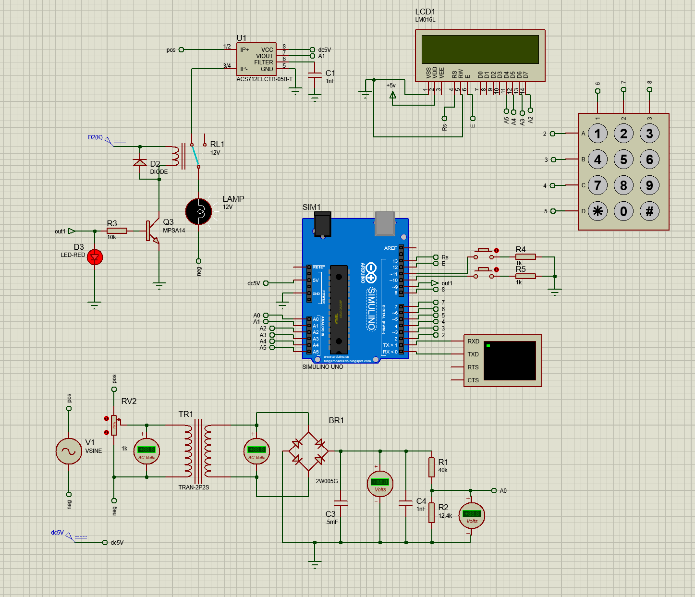

# Microcontroller-Based Voltage and Current Protector

A Proteus-simulated Arduino Uno protection system that monitors supply voltage and load current, disconnects the load when a fault is detected, and allows users to adjust protection limits through a keypad or computer serial terminal.

## Features

- Monitors AC voltage and load current.
- Trips the relay when voltage is outside the configured limits or current exceeds its limit.
- Latches a fault and keeps the load disconnected until the fault clears and the user acknowledges it.
- Displays voltage, current, thresholds, and load status on a 16×2 LCD.
- Provides keypad-based threshold adjustment and manual ON/OFF controls.
- Supports computer communication through the Arduino serial interface.
- Designed and demonstrated in Proteus simulation.

## Schematics

### Block Diagram

### Full Circuit Schematic

## Hardware and Proteus Components

- Arduino Uno
- AC voltage-sensing circuit/model
- ACS712-5A current sensor
- Relay and relay driver stage
- 16×2 LCD
- 4×3 matrix keypad
- Manual OFF and ON/reset push buttons
- Virtual serial terminal for computer communication

## Pin Connections

| Function | Arduino pin |
|---|---|
| Voltage sensor output | A0 |
| ACS712 current sensor output | A1 |
| LCD RS | D13 |
| LCD Enable | D12 |
| LCD D4, D5, D6, D7 | A5, A4, A3, A2 |
| Relay control | D9 |
| Manual OFF button | D10 |
| Manual ON/reset button | D11 |
| Keypad rows | D2, D3, D4, D5 |
| Keypad columns | D6, D7, D8 |
| Serial communication | D0 (RX), D1 (TX) |

**Relay logic in the firmware:** D9 HIGH = load ON; D9 LOW = load OFF. The push buttons are configured with `INPUT_PULLUP` and are active LOW.

## Software Requirements

- Proteus Design Suite
- Arduino IDE
- Arduino Uno board package
- **Keypad** library for Arduino
- Proteus virtual serial terminal (for serial-command testing)

Install the **Keypad** library from the Arduino IDE Library Manager (`Sketch` → `Include Library` → `Manage Libraries…`, then search for `Keypad`). Open the firmware in Arduino IDE, select **Arduino Uno**, compile it, and load the compiled HEX file into the simulated Arduino in Proteus (or use the workflow supported by your Proteus version).

## Default Protection Settings

| Parameter | Default limit |
|---|---:|
| Under-voltage (UV) | 190 V |
| Over-voltage (OV) | 250 V |
| Over-current | 1.60 A |

Threshold changes made through the keypad or serial terminal are stored in RAM and return to the defaults after a restart.

## Keypad Controls

| Key | Action |
|---|---|
| `1` | Increase UV limit by 5 V |
| `7` | Decrease UV limit by 5 V |
| `2` | Increase OV limit by 5 V |
| `8` | Decrease OV limit by 5 V |
| `3` | Increase current limit by 0.05 A |
| `9` | Decrease current limit by 0.05 A |

The manual OFF button (D10) disconnects the load. The manual ON/reset button (D11) requests reconnection; the load will turn on only when active faults have cleared.

## Serial Monitor Commands

Connect the Proteus virtual terminal to the Arduino UART (`D1/TX` to terminal `RXD`, and `D0/RX` to terminal `TXD`) and set the baud rate to **9600**.

Enter one command per line:

| Command | Description | Example |
|---|---|---|
| `HELP` | Lists available commands | `HELP` |
| `STATUS` | Reports readings, limits, and load/fault state | `STATUS` |
| `ON` | Acknowledges/resets a cleared fault and requests load ON | `ON` |
| `OFF` | Manually disconnects the load | `OFF` |
| `SET_UV <volts>` | Sets the under-voltage threshold | `SET_UV 190` |
| `SET_OV <volts>` | Sets the over-voltage threshold | `SET_OV 250` |
| `SET_I <amps>` | Sets the over-current threshold | `SET_I 1.60` |

**Note:** `ON` does not bypass protection. If a fault is still active, the command is rejected and the relay remains OFF.

## Running the Simulation

1. Open the Proteus project and check the sensor, relay, LCD, keypad, buttons, and virtual-terminal wiring.
2. Compile the Arduino firmware with the Arduino Uno board selected and the Keypad library installed.
3. Load the generated firmware HEX file into the simulated Arduino Uno.
4. Start the simulation. At startup, the relay stays OFF while the current sensor's zero-current offset is calibrated; keep the load disconnected during this calibration period.
5. Observe voltage, current, load status, and threshold values on the LCD.
6. Change limits using the keypad or serial commands.
7. Simulate under-voltage, over-voltage, or over-current conditions and confirm that the relay disconnects the load. After the condition clears, use the ON/reset button or `ON` command to acknowledge the fault.

## Video Demonstration

[Watch the project demonstration](https://drive.google.com/file/d/13s1VDaxF5CLpOamlbu1eJNOjr6_YIIag/view?usp=sharing)

## Safety Notice

This repository documents a **simulation project**. Do not connect the shown circuit directly to mains electricity based only on this simulation. A real implementation requires appropriately rated isolation, sensing, relay/contact protection, fusing, enclosure, and qualified electrical design and testing.

## License

No license has been specified yet. Add a license file if you want others to reuse, modify, or distribute this project under stated terms.
